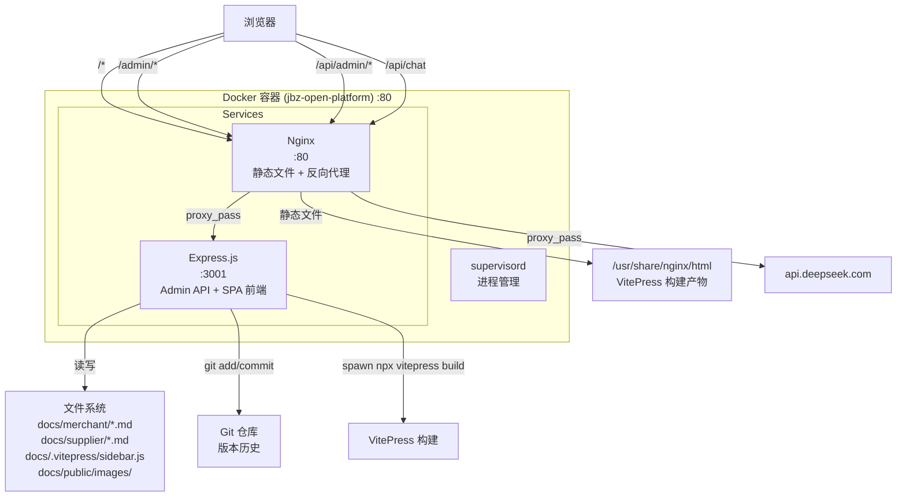
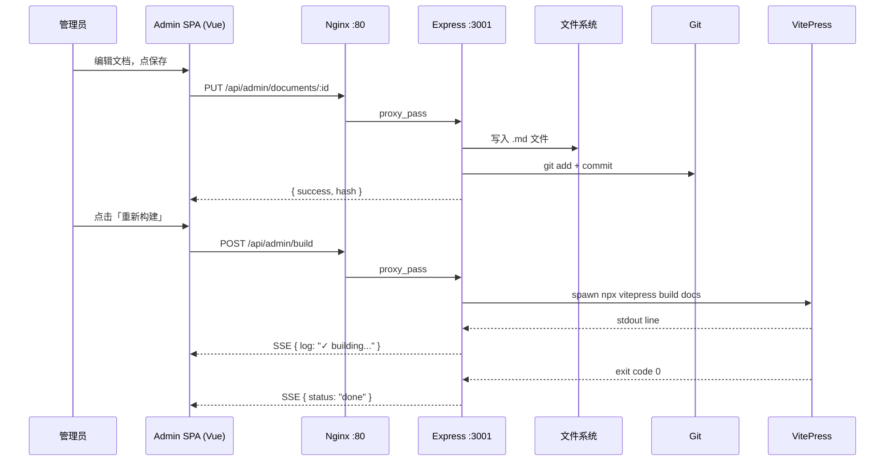

# 管理员后台 - 架构设计文档

## 一、整体架构



## 二、目录结构

```
项目根目录/
├── admin/                          # 新增：管理员后台
│   ├── server/                     # Express 后端
│   │   ├── index.js                # 服务入口
│   │   ├── auth.js                 # 认证中间件 (Session + 密码)
│   │   ├── routes/
│   │   │   ├── documents.js        # 文档 CRUD API
│   │   │   ├── sidebar.js          # 侧边栏管理 API
│   │   │   ├── images.js           # 图片上传 API
│   │   │   └── build.js            # 构建触发 API (SSE)
│   │   └── services/
│   │       ├── fileService.js      # 文件系统读写
│   │       ├── sidebarService.js   # sidebar.js 解析与生成
│   │       └── buildService.js     # VitePress 构建管理
│   └── client/                     # Vue 3 管理前端 (SPA)
│       ├── index.html
│       ├── App.vue
│       ├── router.js
│       ├── views/
│       │   ├── LoginView.vue       # 登录页
│       │   ├── DashboardView.vue   # 仪表盘首页
│       │   ├── DocumentList.vue    # 文档列表 (搜索/筛选)
│       │   ├── DocumentEdit.vue    # 文档编辑器 (ByteMD)
│       │   ├── SidebarManage.vue   # 侧边栏管理
│       │   └── ImageManage.vue     # 图片管理
│       ├── components/
│       │   ├── AdminLayout.vue     # 管理后台布局 (侧边栏+内容)
│       │   ├── MdEditor.vue        # Markdown 编辑器封装
│       │   └── BuildPanel.vue      # 构建进度面板
│       └── api/
│           └── index.js            # API 请求封装 (fetch)
├── docs/                           # 不变
├── Dockerfile                      # 修改：node:20-alpine + nginx + supervisor
├── nginx.conf.template             # 修改：增加 admin 路由代理
├── docker-entrypoint.sh            # 修改：启动 supervisord
├── supervisord.conf                # 新增：进程管理配置
├── package.json                    # 修改：增加 admin 相关依赖
└── .env.example                    # 修改：增加 ADMIN_PASSWORD
```

## 三、核心模块设计

### 3.1 认证模块 (`admin/server/auth.js`)

```javascript
// 流程：
// 1. POST /api/admin/login  { password } → 校验 .env ADMIN_PASSWORD → 签发 session
// 2. 所有 /api/admin/* 请求 → authMiddleware 检查 session
// 3. POST /api/admin/logout → 销毁 session

// Session 存储：express-session + MemoryStore（单容器无需 Redis）
// Cookie: httpOnly, sameSite=strict, maxAge=8h
```

**安全策略：**
- Session ID 使用 `uuid` 随机生成
- 密码使用 `crypto.timingSafeEqual` 防时序攻击
- 连续 5 次登录失败锁定 15 分钟
- 所有管理 API 返回 `Cache-Control: no-store`

### 3.2 文档 CRUD 模块 (`admin/server/routes/documents.js`)

```javascript
// API 路由：
// GET    /api/admin/documents           → 文档列表（分页、搜索、按目录筛选）
// GET    /api/admin/documents/:id       → 单文档详情 (frontmatter + content)
// POST   /api/admin/documents           → 新建文档 { dir, title, content }
// PUT    /api/admin/documents/:id       → 更新文档 { title, content } → git commit
// DELETE /api/admin/documents/:id       → 删除文档 → git commit
// GET    /api/admin/documents/:id/history → git log 获取修改历史
```

**核心逻辑：**

```
新建文档流程:
1. 接收 { dir: "merchant|supplier", title: "xxx" }
2. 生成唯一文件名：nanoid(12) + ".md"
3. 写入 frontmatter（title, 创建时间）+ 空内容
4. 询问是否加入 sidebar（弹出选择菜单节点）
5. git add + commit

更新文档流程:
1. 接收 { title, content }
2. 写 .md 文件（保持 frontmatter，更新内容）
3. git add + commit with message "docs: update {title}"
4. 返回 { success, hash }

删除文档流程:
1. 确认对话框（前端二次确认）
2. 读取 sidebar.js → 移除对应 link
3. 删除 .md 文件
4. git add -A + commit
```

### 3.3 侧边栏管理模块 (`admin/server/routes/sidebar.js`)

```javascript
// API：
// GET    /api/admin/sidebar?dir=merchant|supplier  → 获取完整菜单树 (JSON)
// PUT    /api/admin/sidebar?dir=merchant|supplier   → 全量更新菜单树
// POST   /api/admin/sidebar/node                    → 新增菜单节点
// PUT    /api/admin/sidebar/node/:id                → 修改节点 text/link
// DELETE /api/admin/sidebar/node/:id                → 删除节点
// PUT    /api/admin/sidebar/node/:id/move           → 移动节点 { newParent, position }
```

**sidebar.js 数据结构：**

```javascript
// sidebarService 中定义解析与序列化逻辑：
function parseSidebar() → 返回 [{ id, text, link?, collapsed, items?, children? }]
function serializeSidebar(tree) → 写入 sidebar.js (保持格式)
```

### 3.4 图片管理模块 (`admin/server/routes/images.js`)

```javascript
// API：
// POST /api/admin/images/upload      → 单文件上传 (multer) → docs/public/images/
// GET  /api/admin/images             → 图片列表 (分页)
// DELETE /api/admin/images/:name     → 删除图片
```

**上传流程：**
1. multer 接收文件，限制 5MB + 白名单 (png/jpg/gif/svg/webp)
2. 保留原始文件名（sanitize 后），重名自动加后缀
3. 返回 `{ url: "/images/xxx.png", markdown: "" }`
4. 前端编辑器粘贴图片自动上传并插入 markdown 语法

### 3.5 构建模块 (`admin/server/routes/build.js`)

```javascript
// API：
// POST /api/admin/build           → 触发构建 (SSE 流式推送进度)
// GET  /api/admin/build/status    → 查询最近一次构建状态

// SSE 事件类型：
// - status: { phase: "building"|"done"|"error", progress: "..." }
// - log: { line: "vite v5.x.x building..." }
// - error: { message: "..." }
```

### 3.6 前端管理界面

| 页面 | 路由 | 功能 |
|------|------|------|
| 登录 | `/admin/login` | 密码输入 + 防暴力破解提示 |
| 仪表盘 | `/admin` | 文档总数、最近更新、快捷操作 |
| 文档列表 | `/admin/documents/:dir` | 表格列表，搜索/筛选，排序 |
| 文档编辑 | `/admin/documents/:dir/edit/:id` | ByteMD 分栏编辑器 |
| 新建文档 | `/admin/documents/:dir/new` | 标题输入 → 编辑器 |
| 侧边栏 | `/admin/sidebar/:dir` | 树形结构编辑 |
| 图片管理 | `/admin/images` | 网格预览 + 上传 |

**ByteMD 编辑器集成：**
- 使用 `@bytemd/vue-next` 组件 (vue3 插件)
- 插件：`@bytemd/plugin-gfm` (表格/任务列表)、`@bytemd/plugin-highlight` (代码高亮)
- 工具栏：粗体/斜体/标题/链接/图片/代码块/表格/引用/列表
- 上传适配：自定义 `uploadImages` 函数 → POST /api/admin/images/upload

## 四、数据流图



## 五、Docker 架构变更

### 之前
```
FROM nginx:alpine
├── Nginx :80
└── 启动: nginx -g 'daemon off;'
```

### 之后
```
FROM node:20-alpine                 ← 改为 node 镜像
├── nginx (apk add)                 ← 显式安装
├── supervisord (apk add)           ← 新增进程管理
├── Node.js Express :3001           ← 新增管理服务
├── 启动: supervisord -c /etc/supervisord.conf
│   ├── [program:nginx]    nginx -g 'daemon off;'
│   └── [program:admin]    node admin/server/index.js
```

### supervisord.conf
```ini
[supervisord]
nodaemon=true
logfile=/dev/stdout

[program:nginx]
command=nginx -g "daemon off;"
autorestart=true
stdout_logfile=/dev/stdout
stderr_logfile=/dev/stderr

[program:admin]
command=node /app/admin/server/index.js
directory=/app
autorestart=true
stdout_logfile=/dev/stdout
stderr_logfile=/dev/stderr
environment=NODE_ENV=production
```

## 六、依赖清单

### package.json 新增
```json
{
  "dependencies": {
    "express": "^4.21.0",
    "express-session": "^1.18.0",
    "multer": "^1.4.5-lts.1",
    "nanoid": "^5.0.0",
    "gray-matter": "^4.0.3"
  },
  "scripts": {
    "admin:dev": "node admin/server/index.js"
  }
}
```

### .env 新增
```bash
ADMIN_PASSWORD=admin123  # 管理员登录密码
```

## 七、异常处理策略

| 场景 | 处理方式 |
|------|----------|
| 文件不存在 | 返回 404 `{ error: "DOC_NOT_FOUND" }` |
| Sidebar link 不存在 | 返回 400 `{ error: "INVALID_LINK" }` |
| 图片类型/大小不合法 | multer fileFilter 拒绝，400 |
| 构建失败 | SSE 推送 error 事件，保留错误日志 |
| 构建进行中再次触发 | 返回 409 `{ error: "BUILD_IN_PROGRESS" }` |
| 登录失败过多 | 返回 429 + 锁定提示 |
| Session 过期 | 返回 401，前端跳转登录页 |
| Git 操作失败 | 仅记录日志，不影响保存结果 |
