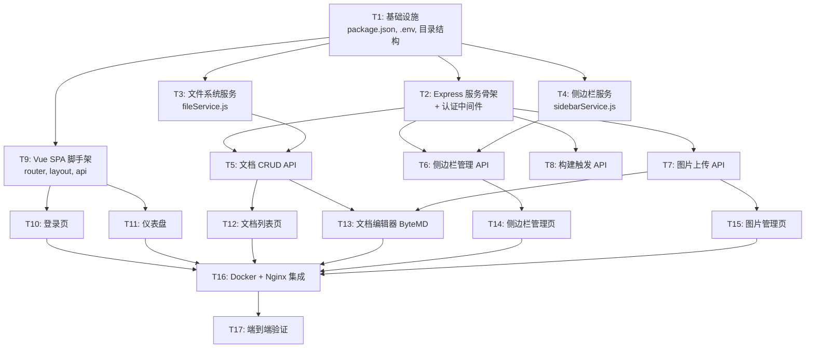

# 管理员后台 - 原子任务拆分

## 任务依赖图



## 子任务清单

---

### T1: 基础设施配置

| 属性 | 内容 |
|------|------|
| **输入** | 现有 `package.json`, `.env.example`, 项目结构 |
| **输出** | 更新 `package.json`（依赖 + scripts）、更新 `.env.example`（ADMIN_PASSWORD）、创建 `admin/` 目录结构 |
| **验收** | `npm install` 成功，`admin/server/`、`admin/client/` 目录就绪 |
| **依赖** | 无 |
| **可并行** | 独立任务 |

**实现内容：**
1. `package.json` 新增依赖：`express`, `express-session`, `multer`, `nanoid`, `gray-matter`, `@bytemd/vue-next`, `@bytemd/plugin-gfm`, `@bytemd/plugin-highlight`
2. `.env.example` 新增 `ADMIN_PASSWORD=your-admin-password`
3. 创建目录：`admin/server/routes/`, `admin/server/services/`, `admin/client/views/`, `admin/client/components/`, `admin/client/api/`

---

### T2: Express 服务骨架 + 认证中间件

| 属性 | 内容 |
|------|------|
| **输入** | T1 目录结构、`.env` 配置 |
| **输出** | `admin/server/index.js` (Express 主入口)、`admin/server/auth.js` (认证中间件) |
| **验收** | `node admin/server/index.js` 启动后 `curl http://localhost:3001/api/admin/login` 返回 401；用正确密码 POST 登录后返回 200 + Set-Cookie |
| **依赖** | T1 |

**实现内容：**
1. Express 服务监听 `ADMIN_PORT` (默认 3001)
2. `express-session` + MemoryStore, cookie httpOnly/sameSite=strict/maxAge 8h
3. 登录防暴力破解：5次失败锁15分钟 (in-memory Map)
4. 密码使用 `crypto.timingSafeEqual` 比较
5. 所有 `/api/admin/*` 请求经过 `authMiddleware` 检查 session

---

### T3: 文件系统服务

| 属性 | 内容 |
|------|------|
| **输入** | T1 目录结构 |
| **输出** | `admin/server/services/fileService.js` |
| **验收** | 单测覆盖：读取 .md 文件 → 返回 frontmatter+content；写入 → 文件内容正确；删除 → 文件不存在；列表 → 返回所有文档元数据 |
| **依赖** | T1 |

**实现内容：**
1. `listDocuments(dir)` - 扫描 `docs/{dir}/` 下所有 .md，用 gray-matter 解析 frontmatter，返回 `[{ id, title, dir, updatedAt }]`
2. `getDocument(dir, id)` - 读取单个 .md，返回 `{ title, content, frontmatter }`
3. `createDocument(dir, title)` - 创建新 .md (nanoid 文件名 + frontmatter)，返回 `{ id, path }`
4. `updateDocument(dir, id, title, content)` - 覆盖写入 .md
5. `deleteDocument(dir, id)` - 删除 .md
6. `slugFromTitle(title)` - 去掉序号前缀生成文件名

---

### T4: 侧边栏服务

| 属性 | 内容 |
|------|------|
| **输入** | T1 目录结构、现有 `sidebar.js` |
| **输出** | `admin/server/services/sidebarService.js` |
| **验收** | `parseSidebar()` 返回树结构；`addNode()` 正确插入；`removeNode()` 正确删除；`serializeSidebar()` 输出合法 JavaScript |
| **依赖** | T1 |

**实现内容：**
1. `parseSidebar(dir)` - 读取 `sidebar.js`，解析对应 `/{dir}/` 的菜单树为 JSON
2. `serializeSidebar(dir, tree)` - 将 JSON 树写回 `sidebar.js`，保持代码格式
3. `addNode(dir, parentId, node)` - 在指定父节点下新增 `{ text, link?, items? }`
4. `removeNode(dir, nodeId)` - 按路径索引删除节点
5. `updateNode(dir, nodeId, patch)` - 修改 text 或 link

---

### T5: 文档 CRUD API

| 属性 | 内容 |
|------|------|
| **输入** | T2 (Express + Auth)、T3 (fileService) |
| **输出** | `admin/server/routes/documents.js` |
| **验收** | curl 测试：GET 列表/详情、POST 新建、PUT 更新、DELETE 删除、GET 历史。新建后文件存在；更新后内容正确；删除后文件消失 |
| **依赖** | T2, T3 |

**实现内容：**
1. `GET /api/admin/documents?dir=merchant&page=1&size=20&search=xxx` - 分页 + 搜索
2. `GET /api/admin/documents/:id?dir=merchant` - 单文档详情
3. `POST /api/admin/documents` - 新建 `{ dir, title, content? }` → 调用 fileService.createDocument
4. `PUT /api/admin/documents/:id` - 更新 `{ dir, title, content }` → fileService.updateDocument → git commit
5. `DELETE /api/admin/documents/:id` - 删除 `{ dir }` → fileService.deleteDocument → git commit
6. `GET /api/admin/documents/:id/history?dir=merchant` - `git log --oneline -- docs/{dir}/{id}.md`

---

### T6: 侧边栏管理 API

| 属性 | 内容 |
|------|------|
| **输入** | T2 (Express + Auth)、T4 (sidebarService) |
| **输出** | `admin/server/routes/sidebar.js` |
| **验收** | curl 测试：GET 树结构完整、POST 新增节点后 sidebar.js 正确、PUT 修改生效、DELETE 正确移除 |
| **依赖** | T2, T4 |

**实现内容：**
1. `GET /api/admin/sidebar?dir=merchant` - 调用 sidebarService.parseSidebar → JSON 树
2. `PUT /api/admin/sidebar?dir=merchant` - 全量更新 → serialize + git commit
3. `POST /api/admin/sidebar/node` - `{ dir, parentId, node }` → addNode
4. `PUT /api/admin/sidebar/node/:nodeId` - `{ dir, patch }` → updateNode
5. `DELETE /api/admin/sidebar/node/:nodeId` - `{ dir }` → removeNode

---

### T7: 图片上传 API

| 属性 | 内容 |
|------|------|
| **输入** | T2 (Express + Auth) |
| **输出** | `admin/server/routes/images.js` |
| **验收** | curl 上传 png → 200 + url/markdown；上传 .exe → 400；图片文件出现在 `docs/public/images/` 下 |
| **依赖** | T2 |

**实现内容：**
1. `POST /api/admin/images/upload` - multer 单文件，限制 5MB，白名单 png/jpg/gif/svg/webp，sanitize 文件名
2. `GET /api/admin/images?page=1&size=20` - 列出 `docs/public/images/` 下图片
3. `DELETE /api/admin/images/:name` - 删除图片文件

---

### T8: 构建触发 API (SSE)

| 属性 | 内容 |
|------|------|
| **输入** | T2 (Express + Auth) |
| **输出** | `admin/server/routes/build.js`, `admin/server/services/buildService.js` |
| **验收** | curl POST 触发构建 → SSE 流输出 VitePress 构建日志 → 最终 status: done；构建中再触发 → 409 |
| **依赖** | T2 |

**实现内容：**
1. `POST /api/admin/build` - SSE 响应，`child_process.spawn('npx', ['vitepress', 'build', 'docs'])`，stdout/stderr 逐行推送
2. `GET /api/admin/build/status` - `{ running: bool, lastResult: { success, time, error? } }`
3. `buildService.js` 管理构建状态 (in-memory)，防止并发构建

---

### T9: Vue SPA 脚手架

| 属性 | 内容 |
|------|------|
| **输入** | T1 依赖安装 |
| **输出** | `admin/client/index.html`, `App.vue`, `router.js`, `api/index.js`, `components/AdminLayout.vue` |
| **验收** | Express 提供 `/admin` → 返回 SPA；前端路由 `/admin/login`、`/admin/documents` 正常渲染 |
| **依赖** | T1 |

**实现内容：**
1. `index.html` - 轻量 HTML，挂载 `#app`，引用 Vue3 CDN + ByteMD CSS
2. `router.js` - vue-router (hash mode) 路由表
3. `App.vue` - `<router-view>` 根组件
4. `AdminLayout.vue` - 左侧管理菜单 + 顶部标题栏 + `<router-view>` 内容区
5. `api/index.js` - fetch 封装，自动带 credentials，401 跳登录

---

### T10: 登录页

| 属性 | 内容 |
|------|------|
| **输入** | T2 (Auth API)、T9 (SPA 脚手架) |
| **输出** | `admin/client/views/LoginView.vue` |
| **验收** | 访问 `/admin` 未登录 → 跳转登录页；输入错误密码 → 错误提示；正确密码 → 跳转仪表盘 |
| **依赖** | T2, T9 |

---

### T11: 仪表盘

| 属性 | 内容 |
|------|------|
| **输入** | T5 (Documents API)、T9 (SPA 脚手架) |
| **输出** | `admin/client/views/DashboardView.vue` |
| **验收** | 显示商家版/供应商版文档数量、最近更新列表、快捷操作按钮 |
| **依赖** | T5, T9 |

---

### T12: 文档列表页

| 属性 | 内容 |
|------|------|
| **输入** | T5 (Documents API)、T9 (SPA 脚手架) |
| **输出** | `admin/client/views/DocumentList.vue` |
| **验收** | 表格显示文档标题/目录/更新时间；搜索框实时过滤；点击编辑跳转编辑器；点击删除弹确认框 |
| **依赖** | T5, T9 |

---

### T13: 文档编辑器 (ByteMD)

| 属性 | 内容 |
|------|------|
| **输入** | T5 (Documents API)、T7 (Images API)、T9 (SPA 脚手架) |
| **输出** | `admin/client/views/DocumentEdit.vue`, `admin/client/components/MdEditor.vue` |
| **验收** | 左 Markdown 编辑右预览；工具栏正常（标题/粗体/表格/代码块）；粘贴图片自动上传并插入；Ctrl+S 保存；保存后提示成功 |
| **依赖** | T5, T7, T9 |

---

### T14: 侧边栏管理页

| 属性 | 内容 |
|------|------|
| **输入** | T6 (Sidebar API)、T9 (SPA 脚手架) |
| **输出** | `admin/client/views/SidebarManage.vue` |
| **验收** | 树形结构展示菜单；可新增/修改/删除节点；编辑 link 指向现有文档；保存后 sidebar.js 正确更新 |
| **依赖** | T6, T9 |

---

### T15: 图片管理页

| 属性 | 内容 |
|------|------|
| **输入** | T7 (Images API)、T9 (SPA 脚手架) |
| **输出** | `admin/client/views/ImageManage.vue` |
| **验收** | 网格展示已上传图片；拖拽/点击上传新图片；点击复制 Markdown 引用；删除确认 |
| **依赖** | T7, T9 |

---

### T16: Docker + Nginx 集成

| 属性 | 内容 |
|------|------|
| **输入** | T1-T15 全部完成 |
| **输出** | 更新 `Dockerfile`, `nginx.conf.template`, `docker-entrypoint.sh`, 新增 `supervisord.conf` |
| **验收** | `docker compose up --build -d` 成功；访问 `/admin` → 管理后台；访问 `/merchant/` → 文档正常 |
| **依赖** | T1-T15 |

**实现内容：**
1. `Dockerfile`：运行阶段改为 `node:20-alpine`，安装 nginx + supervisor，复制 admin/ 源码，同时构建 VitePress dist + admin SPA
2. `nginx.conf.template`：新增 `/admin` 和 `/api/admin` 的 proxy_pass 到 `http://127.0.0.1:3001`
3. `supervisord.conf`：管理 nginx + node 进程
4. `docker-entrypoint.sh`：替换为 `supervisord -c /etc/supervisord.conf`
5. `docker-compose.yml`：增加 `ADMIN_PASSWORD` 环境变量

---

### T17: 端到端验证

| 属性 | 内容 |
|------|------|
| **输入** | T16 部署完成 |
| **输出** | 测试报告 |
| **验收** | 全流程测试：登录 → 新建文档 → 编辑保存 → 查看文档 → 上传图片 → 管理侧边栏 → 一键构建 → 访问公网页面 |
| **依赖** | T16 |

---

## 执行顺序建议

```
阶段A (并行): T1, T3, T4  ← 基础设施
阶段B: T2                     ← Express 骨架
阶段C (并行): T5, T6, T7, T8 ← 后端 API
阶段D: T9                     ← 前端脚手架
阶段E (并行): T10, T11, T12, T13, T14, T15 ← 前端页面
阶段F: T16                    ← Docker 集成
阶段G: T17                    ← 验收
```
