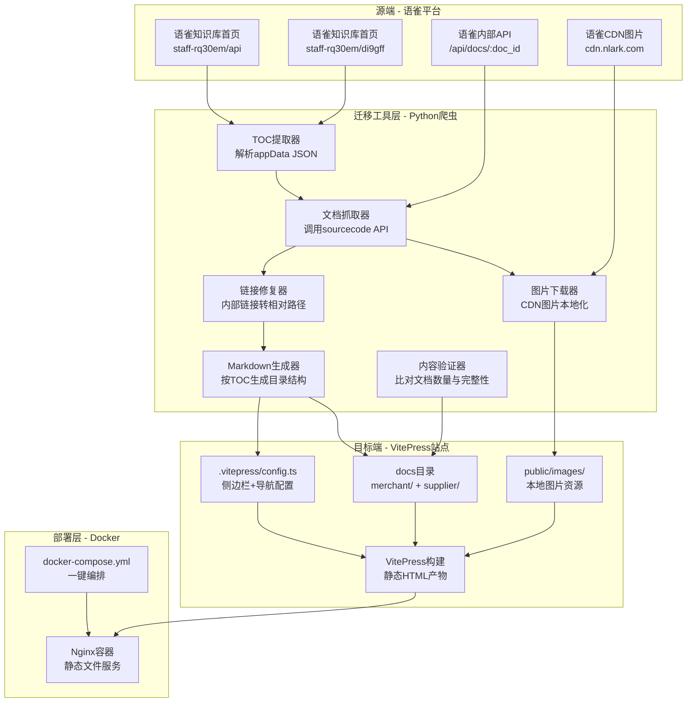
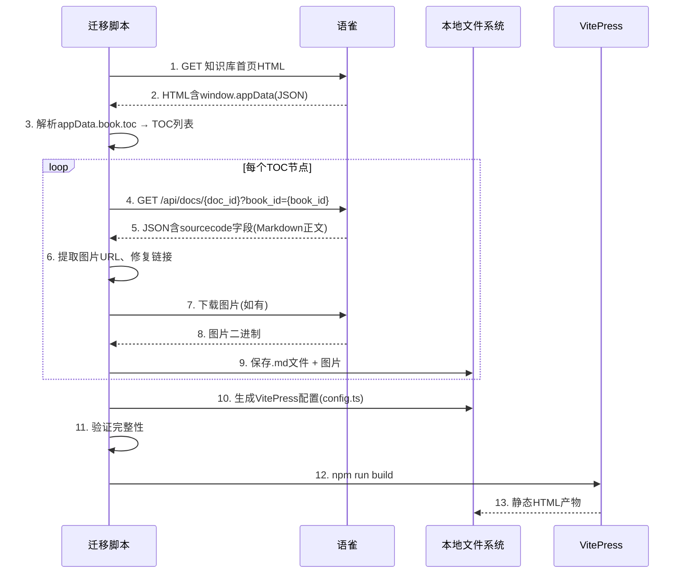

# DESIGN - 聚宝赞开放平台系统架构设计

> 阶段2: Architect 架构阶段产出
> 创建时间: 2026-07-07

---

## 一、整体架构图



---

## 二、分层设计与核心组件

### 2.1 迁移工具层（Python爬虫）

#### 组件1：TOC提取器 (`toc_extractor.py`)
- **职责**：从语雀知识库首页HTML提取 `window.appData` JSON，解析TOC树
- **输入**：知识库URL（如 `https://jubaozan.yuque.com/staff-rq30em/api`）
- **输出**：TOC列表 `[{title, doc_id, url, level, parent_uuid, ...}]`
- **关键逻辑**：正则匹配 `window.appData = JSON.parse(decodeURIComponent("..."))` → 解析JSON → 返回 `book.toc`

#### 组件2：文档抓取器 (`doc_crawler.py`)
- **职责**：调用语雀内部API获取每篇文档的Markdown正文
- **输入**：doc_id, book_id
- **输出**：Markdown字符串（sourcecode字段）
- **API**：`GET /api/docs/{doc_id}?book_id={book_id}&merge_dynamic_data=false`
- **限流**：并发3，请求间隔1秒，指数退避重试

#### 组件3：图片下载器 (`image_downloader.py`)
- **职责**：提取Markdown中的图片URL，下载到本地，替换链接
- **输入**：Markdown字符串, book_slug
- **输出**：处理后的Markdown + 已下载图片列表
- **图片域名**：cdn.nlark.com, mdn.alipayobjects.com, gw.alipayobjects.com
- **存储路径**：`public/images/{book_slug}/{hash}.png`
- **去重**：按URL hash去重

#### 组件4：链接修复器 (`link_fixer.py`)
- **职责**：将语雀内部链接转换为VitePress相对路径
- **输入**：Markdown字符串, TOC映射表
- **输出**：处理后的Markdown
- **规则**：
  - `https://jubaozan.yuque.com/staff-rq30em/api/{slug}` → `./{对应文件}.md`
  - 外部链接保持不变

#### 组件5：Markdown生成器 (`markdown_generator.py`)
- **职责**：按TOC层级生成VitePress目录结构与.md文件
- **输入**：处理后的Markdown, TOC节点信息
- **输出**：文件系统中的.md文件 + 侧边栏配置
- **目录规则**：按TOC的level和parent_uuid重建层级

#### 组件6：内容验证器 (`verifier.py`)
- **职责**：验证迁移完整性
- **检查项**：
  - 文档数量比对（语雀TOC数 vs 本地文件数）
  - 图片完整性（Markdown引用的图片本地是否存在）
  - 链接有效性（内部链接指向的文件是否存在）
  - 空文件检测

### 2.2 VitePress站点层

#### 目录结构
```
JBZ-OpenPlatform/
├── docs/
│   ├── merchant/              # 商家版文档
│   │   ├── index.md           # 首页（语雀概述页）
│   │   ├── solution/          # 解决方案
│   │   ├── guide/             # 接入指南
│   │   └── api/               # 通用接口
│   ├── supplier/              # 供应商版文档
│   │   ├── index.md
│   │   ├── guide/
│   │   └── api/
│   ├── public/
│   │   └── images/
│   │       ├── merchant/      # 商家版图片
│   │       └── supplier/      # 供应商版图片
│   └── .vitepress/
│       ├── config.ts          # 站点配置
│       └── theme/             # 主题（可选定制）
├── tools/
│   └── yuque-migrator/        # 迁移工具
│       ├── toc_extractor.py
│       ├── doc_crawler.py
│       ├── image_downloader.py
│       ├── link_fixer.py
│       ├── markdown_generator.py
│       ├── verifier.py
│       ├── main.py            # 主入口
│       └── requirements.txt
├── Dockerfile
├── docker-compose.yml
├── Makefile
└── package.json
```

#### VitePress配置要点
- 顶部导航：商家版 / 供应商版 / 首页
- 侧边栏：根据TOC自动生成
- 搜索：本地搜索（VitePress内置）
- 主题：默认主题 + 聚宝赞品牌色

### 2.3 部署层

#### Dockerfile
```dockerfile
# 构建阶段
FROM node:20-alpine AS builder
WORKDIR /app
COPY package*.json ./
RUN npm ci
COPY docs/ ./docs/
RUN npm run build

# 运行阶段
FROM nginx:alpine
COPY --from=builder /app/docs/.vitepress/dist /usr/share/nginx/html
COPY nginx.conf /etc/nginx/conf.d/default.conf
EXPOSE 80
```

#### docker-compose.yml
```yaml
version: '3.8'
services:
  open-platform-docs:
    build: .
    ports:
      - "8080:80"
    restart: unless-stopped
```

#### Makefile
```makefile
migrate:
	python tools/yuque-migrator/main.py

build-docs:
	npm run build

deploy:
	docker compose up -d --build

dev:
	npm run docs:dev

verify:
	python tools/yuque-migrator/verifier.py
```

---

## 三、数据流向图



---

## 四、异常处理策略

| 异常场景 | 处理方式 |
|---|---|
| 语雀API请求失败(429/5xx) | 指数退避重试3次，间隔2/4/8秒 |
| 文档sourcecode为空 | 记录警告日志，生成占位.md文件 |
| 图片下载失败 | 记录失败URL，保留原始链接，验证阶段报告 |
| 内部链接找不到对应文档 | 保留原始链接，验证阶段报告 |
| TOC节点无doc_id（标题节点） | 跳过，仅作为目录层级 |
| 网络超时 | 30秒超时，重试 |

---

## 五、设计原则

1. **严格按任务范围**：仅迁移文档，不添加额外功能
2. **复用现有工具**：使用Python标准库 + requests，不引入重型框架
3. **可重跑**：迁移脚本支持幂等执行，重复运行不会产生副作用
4. **可验证**：每个环节有日志输出，最终有验证报告
5. **简单部署**：`make migrate && make deploy` 两步完成
