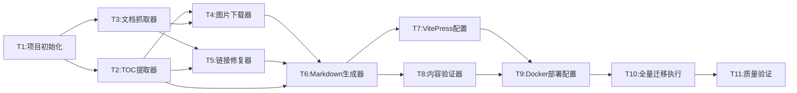

# TASK - 原子任务拆分

> 阶段3: Atomize 原子化阶段产出
> 创建时间: 2026-07-07

---

## 一、任务依赖图



---

## 二、原子任务清单

### T1: 项目初始化
- **输入**：无
- **输出**：项目骨架（package.json、目录结构、.gitignore）
- **实现**：
  - 初始化npm项目，安装VitePress
  - 创建目录结构：docs/、tools/yuque-migrator/、public/images/
  - 创建 .gitignore（node_modules、.env、dist）
  - 创建 Python requirements.txt（requests）
- **验收**：`npm run docs:dev` 可启动空白VitePress站点
- **依赖**：无

### T2: TOC提取器 (`toc_extractor.py`)
- **输入**：知识库URL
- **输出**：TOC列表 `[{title, doc_id, url, level, parent_uuid, child_uuid}]`
- **实现**：
  - `get_book_info(book_url)` → 返回book_id, toc列表
  - 正则匹配 `window.appData = JSON.parse(decodeURIComponent("..."))`
  - 解析JSON，返回 `book.toc`
  - 过滤 `type != "DOC"` 或 `doc_id` 为空的节点（仅保留可抓取文档）
- **验收**：商家版返回160条、供应商版返回56条TOC记录
- **依赖**：T1

### T3: 文档抓取器 (`doc_crawler.py`)
- **输入**：doc_id, book_id
- **输出**：Markdown字符串
- **实现**：
  - `fetch_doc(doc_id, book_id)` → 调用 `/api/docs/{doc_id}?book_id={book_id}`
  - 提取 `data.sourcecode` 字段
  - 限流：并发3，间隔1秒，指数退避重试
  - 超时30秒
- **验收**：成功获取"认证鉴权"文档（doc_id=147109531）的Markdown正文
- **依赖**：T1

### T4: 图片下载器 (`image_downloader.py`)
- **输入**：Markdown字符串, book_slug
- **输出**：处理后的Markdown + 已下载图片路径列表
- **实现**：
  - `extract_images(markdown)` → 正则提取图片URL
  - `download_image(url, save_path)` → 下载图片，带Referer头
  - `replace_image_links(markdown, url_map)` → 替换为 `/images/{book_slug}/xxx.png`
  - 图片域名：cdn.nlark.com, mdn.alipayobjects.com, gw.alipayobjects.com
  - 按URL hash命名，去重
- **验收**：测试文档中的图片下载到本地，Markdown中URL已替换
- **依赖**：T1, T2, T3

### T5: 链接修复器 (`link_fixer.py`)
- **输入**：Markdown字符串, TOC映射表(url→文件路径)
- **输出**：处理后的Markdown
- **实现**：
  - `fix_internal_links(markdown, toc_map)` 
  - 识别语雀内部链接 `https://jubaozan.yuque.com/staff-rq30em/{book_slug}/{doc_url}`
  - 通过TOC映射表查找对应的本地文件路径
  - 替换为VitePress相对路径
  - 外部链接保持不变
- **验收**：内部链接已转换为相对路径，外部链接不变
- **依赖**：T1, T2, T3

### T6: Markdown生成器 (`markdown_generator.py`)
- **输入**：TOC列表 + 各文档处理后的Markdown
- **输出**：文件系统中的.md文件 + 目录结构
- **实现**：
  - `generate_dir_structure(toc)` → 按level和parent_uuid生成目录树
  - `generate_markdown_file(toc_node, content, output_dir)` → 写入.md文件
  - 文件名：使用TOC节点的url字段作为文件名（保证唯一性）
  - 对于无doc_id的标题节点：创建目录或index.md
  - 自动生成 `.vitepress/sidebar.ts`（侧边栏配置）
- **验收**：生成完整的merchant/和supplier/目录，文件数=TOC文档数
- **依赖**：T2, T3, T4, T5

### T7: VitePress配置
- **输入**：生成的文档目录结构
- **输出**：`.vitepress/config.ts`
- **实现**：
  - 站点标题、描述
  - 顶部导航：首页 / 商家版 / 供应商版
  - 侧边栏：自动引用T6生成的sidebar配置
  - 搜索：本地搜索
  - 首页配置（docs/index.md）
- **验收**：`npm run docs:dev` 显示完整站点，导航和侧边栏正确
- **依赖**：T6

### T8: 内容验证器 (`verifier.py`)
- **输入**：语雀TOC + 本地文件目录
- **输出**：验证报告（控制台输出 + 日志文件）
- **实现**：
  - 文档数量比对
  - 图片完整性检查（Markdown引用的图片文件是否存在）
  - 内部链接有效性检查
  - 空文件检测
  - 输出统计摘要
- **验收**：执行后输出"216/216文档迁移完成，0个错误"
- **依赖**：T6

### T9: Docker部署配置
- **输入**：VitePress构建产物
- **输出**：Dockerfile + docker-compose.yml + Makefile + nginx.conf
- **实现**：
  - 多阶段构建Dockerfile（node构建 → nginx运行）
  - docker-compose.yml：端口映射、重启策略
  - nginx.conf：静态文件服务配置
  - Makefile：migrate/build/deploy/dev/verify 命令
- **验收**：`make deploy` 成功启动容器，浏览器可访问
- **依赖**：T7, T8

### T10: 全量迁移执行
- **输入**：完成的迁移工具
- **输出**：216篇文档 + 图片全部迁移到本地
- **实现**：
  - 执行 `python tools/yuque-migrator/main.py`
  - 分两批执行：商家版、供应商版
  - 实时输出进度
- **验收**：本地生成216个.md文件，所有图片下载完成
- **依赖**：T1-T9全部完成

### T11: 质量验证
- **输入**：迁移产物
- **输出**：验证报告 + 修复（如有必要）
- **实现**：
  - 执行 `python tools/yuque-migrator/verifier.py`
  - `npm run build` 确认VitePress构建无错误
  - `make deploy` 确认部署成功
  - 浏览器访问确认页面正常
- **验收**：所有验收标准满足
- **依赖**：T10

---

## 三、任务执行顺序

```
第1批（可并行）：T1
第2批（可并行）：T2, T3
第3批（可并行）：T4, T5
第4批：T6
第5批（可并行）：T7, T8
第6批：T9
第7批：T10
第8批：T11
```

---

## 四、质量门控

- [x] 任务覆盖完整需求（216篇文档 + 图片 + 链接 + 部署）
- [x] 依赖关系无循环
- [x] 每个任务可独立验证
- [x] 复杂度可控（每个脚本单一职责）
